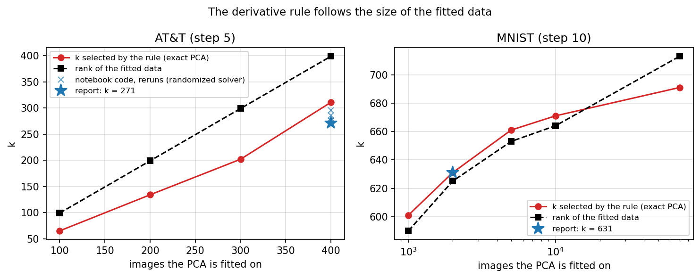
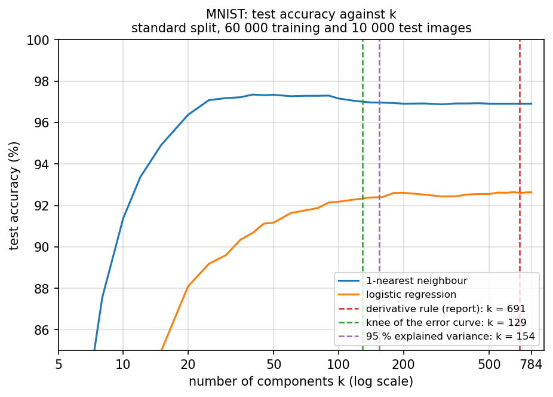

# Optimization of Principal Component Selection for Enhanced Classification Performance

How many principal components should PCA keep? This course project measures the PCA reconstruction
error on the AT&T faces and on MNIST for every number of components k, and picks k with a rule based
on the first derivative of that error curve. This repository holds the code behind the report
([docs/report.pdf](docs/report.pdf)): the original notebooks, a cleaned and tested version that
reproduces the report's figures, a check of the selection rule, and the classification experiment
that the title promises but the report does not contain.

## Results

**The report's rule, reproduced.** PCA is fitted on N images and the error is measured on the same
images. k is the first point where the slope dE/dk is about zero or, if there is none, the point with
the largest slope.

| | AT&T | MNIST |
|---|---|---|
| images the PCA is fitted on | 400 | the first 2 000 |
| k in the report | 271 | 631 |
| k here (exact PCA) | 311 | 631 |
| rank of the fitted images | 399 | 625 |

**What the rule measures.** When the PCA is fitted and measured on the same N images, the error drops
to zero at the rank of those images, which is at most N − 1. On MNIST the rule therefore lands
next to the rank: 601, 631, 661, 671 and 691 components for 1 000, 2 000, 5 000, 10 000 and 70 000
images (ranks 590, 625, 653, 664 and 713). On AT&T no slope reaches
zero, so the rule picks the largest of many nearly equal slopes, at about 0.65 N. The notebook's
unseeded randomized PCA solver gives anything from 261 to 311 when it is rerun. The k this rule
selects follows the number of images, not the information in them. Details:
[docs/notes.md](docs/notes.md) ([Türkçe](docs/notes.tr.md)).



**Classification (added here).** The images are split into training and test sets. PCA and the rules
use only the training images. 1-nearest neighbour (1-NN) and logistic regression run on the first k
PCA scores. Test accuracy in %:

| rule | AT&T k | 1-NN | log. regression | MNIST k | 1-NN | log. regression |
|---|---|---|---|---|---|---|
| derivative rule of the report | 137 | 93.8 | 95.6 | 691 | 96.91 | 92.63 |
| knee of the error curve | 34 | 93.6 | 95.5 | 129 | 97.04 | 92.42 |
| 95 % explained variance | 115 | 93.8 | 95.8 | 154 | 96.94 | 92.29 |
| all components | 200 | 93.8 | 95.7 | 784 | 96.91 | 92.63 |
| best k on the test set (1-NN / log. regression), for reference | 50 / 85 | 94.1 | 96.0 | 40 / 650 | 97.35 | 92.64 |

AT&T: mean of 10 random splits with 5 training and 5 test images per person. Results vary by about
±1 point between splits. MNIST: the standard 60 000 / 10 000 split.

Accuracy levels off long before the k that the derivative rule selects. On AT&T both classifiers
level off at about 40–50 components. On MNIST, 1-NN peaks at about 40 and logistic regression levels
off at about 200. The rule keeps 137 and 691 components and gains nothing for it; on MNIST its 1-NN
accuracy is 0.4 points below the peak at k = 40. The knee of the same error curve is the derivative
rule with a cost per component ([notes, section 4](docs/notes.md#4-a-derivative-rule-with-a-cost-per-component)).
It uses 4–5× fewer components (34 and 129) and stays within 0.3 points of the derivative rule for
both classifiers on both datasets.



## Layout

```
pcaselect/   library: data loading, PCA error curves, selection rules, classifiers, plots
scripts/     reproduce_report.py, check_rule.py, classify.py
results/     figures and tables written by the scripts
tests/       pytest suite
legacy/      the notebooks behind the report (June 2025), code and outputs unchanged
docs/        the report, the slides, notes on what was checked and changed (EN / TR)
```

## Usage

```bash
pip install -r requirements.txt
```

The datasets are downloaded into `data/` on the first run: the AT&T faces from Kaggle (no account
needed) and MNIST from OpenML.

```bash
python scripts/reproduce_report.py --dataset att     # the report's Fig. 1-4, ~10-20 s
python scripts/reproduce_report.py --dataset mnist
python scripts/check_rule.py                         # what the rule depends on, ~5 min
python scripts/classify.py --dataset att             # accuracy against k, ~1 min
python scripts/classify.py --dataset mnist           # ~4 min
python -m pytest                                     # tests
```

Every script lists its options with `--help`. Outputs go to `results/`.

## Report

Esra Vural, Kerem Bal, Zeynep Sena Güller. *Optimization of Principal Component Selection for
Enhanced Classification Performance.* Course project report, June 2025.
[PDF](docs/report.pdf) · [slides](docs/presentation.pptx)
