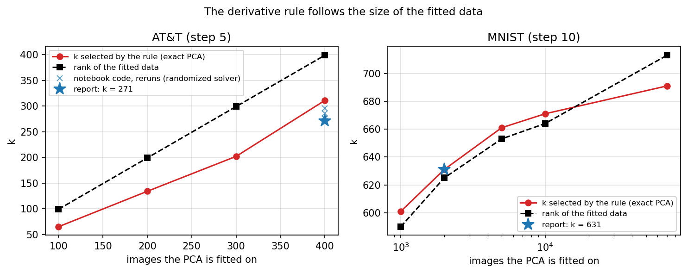
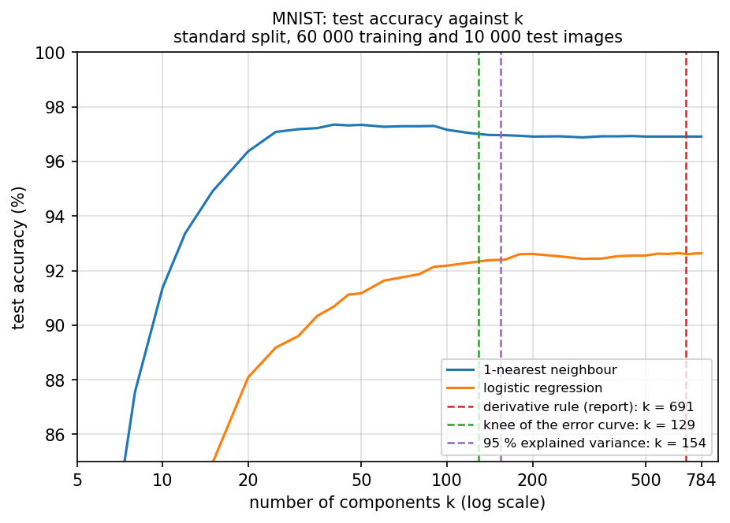

# Notes on the code and the report

[Türkçe](notes.tr.md)

## 1. Where the code comes from

The report ([report.pdf](report.pdf)) links to a Google Drive folder with two notebooks
(`atnt_opt.ipynb`, `mnist_opt.ipynb`), the slides and a recorded presentation. The notebooks are in
[legacy/](../legacy) with their code and outputs unchanged. Only the Colab metadata (user id, Drive
file ids) was removed. The slides are in [presentation.pptx](presentation.pptx); the video is not in
the repository.

Both notebooks do the same thing:

1. load the images (pixel values 0–255) and fit PCA on them;
2. for k = 1, 1 + s, 1 + 2s, … reconstruct the same images from k components and take the mean
   Euclidean distance to the originals, E(k);
3. take the slope dE/dk with `np.gradient`;
4. select the first k where |slope| ≤ 0.01, or, if there is none, the k with the largest slope.

## 2. Where the report and the code differ

- **The rule.** The report says the optimum is where the first derivative "reaches its maximum",
  which "reflects the steepest improvement". E(k) decreases, so its slope is negative, and its
  maximum is where the error decreases *least*. The code does this, and so do the slides ("the point
  where the error decreases least rapidly (derivative closest to zero)"). The steepest improvement is
  at k = 1.
- **AT&T grid.** The report says steps of 10; the notebook uses steps of 5 (`range(1, 401, 5)`).
- **MNIST sample.** The report describes 70 000 images. The error curve uses only the first 2 000:
  PCA is fitted and evaluated on them. Only the reconstruction figures use all 70 000.
- **Reduction percentages.** 32.25 % and 19.52 % are 1 − 271/400 and 1 − 631/784. On AT&T the
  original dimension is 10 304 pixels, so 271 components is a 97.4 % reduction. The 400 is the
  number of images, not a property of the images.
- **Classification.** The title is about classification performance, but no classifier is trained
  or evaluated.

## 3. Why the selected k is not an optimum

### The in-sample error reaches zero

PCA is fitted on N images and evaluated on the same images. N centred images span at most N − 1
dimensions, so the error is exactly zero from k = rank (≤ N − 1) on, and so is the slope. A rule that
looks for a zero slope finds the rank of the sample ([results/rule_check.md](../results/rule_check.md)):

| MNIST images fitted (the first n) | rank of the data | k, step 1 | k, step 10 |
|---|---|---|---|
| 1 000 | 590 | 589 | 601 |
| 2 000 | 625 | 624 | 631 |
| 5 000 | 653 | 653 | 661 |
| 10 000 | 664 | 664 | 671 |
| 70 000 | 713 | 680 | 691 |

The report's 631 is the first grid point after the rank of its 2 000-image sample. With all 70 000
images the same rule gives 691.

### On AT&T the result is decided by noise

With step 5 the grid ends at k = 396, before the rank (399), so no slope is zero and the rule takes
the largest slope. The error is a Euclidean distance, the square root of the residual energy, so the
curve steepens again just before the rank. Over a long stretch in between, the slope is almost
constant: the five largest slopes (k = 266 … 311) lie between −3.67 and −3.72. Which one is the
largest depends on details:

- The notebook calls sklearn's `PCA(n_components=k)` with the default solver. For most k on this data
  that solver is randomized and it is not seeded. Eight reruns (five of them are in
  [results/rule_check.md](../results/rule_check.md)) gave 261, 271, 271, 276, 276, 286, 296 and 311.
  The report's 271 is one such run.
- Exact PCA gives 311 with step 5, 281 with step 10 and 400 with step 1.
- With fewer images the result shrinks with the number of images, at about 0.65 N:

| AT&T images fitted (random subsets) | rank | k, step 1 | k, step 5 | k, step 10 |
|---|---|---|---|---|
| 100 | 99 | 100 | 65 (56–71) | 61 |
| 200 | 199 | 200 | 134 (126–141) | 133 (131–141) |
| 300 | 299 | 300 | 202 (186–206) | 207 (191–211) |
| 400 | 399 | 400 | 311 | 281 |

### The tolerance has units

|slope| ≤ 0.01 is measured in pixel units per component. With pixels scaled to 0–1 instead of 0–255, the
same rule picks a different k.

So the k this rule returns describes how many images the PCA was fitted on, not how much information
the components carry.

## 4. A derivative rule with a cost per component

Choosing k is a trade-off. Minimise J(k) = E(k) + λk, where λ is the cost of one more component. At
the optimum dE/dk = −λ: stop adding components once one more component lowers the error by less than
it costs. The report's rule is the case λ ≈ 0, so it keeps adding components until the error is zero.

A choice of λ without a tuning parameter is the average gain per component over the whole range,
λ = (E(1) − E(K)) / (K − 1). The k where the slope equals this value is the point of the curve
farthest below the straight line from its first to its last point: the knee (Kneedle without
smoothing). `pcaselect.selection.knee_rule` implements it. On the report's own curves it gives
k = 61 (AT&T, 400 images) and k = 135 (MNIST, 2 000 images).

## 5. Classification (added)

The title asks about classification performance, so [scripts/classify.py](../scripts/classify.py)
measures it.

- **Data.** AT&T: 10 random splits with 5 training and 5 test images per person (200 + 200). MNIST:
  the standard split, 60 000 training and 10 000 test images.
- **No test data in the choice of k.** PCA is fitted on the training images only, and every rule sees
  only the training images: the report's rule on the in-sample error curve (step 5 on AT&T and 10 on
  MNIST, as in the report), the knee of the same curve, and 95 % explained variance.
- **Classifiers.** 1-nearest neighbour (1-NN, the classic eigenfaces recogniser) and logistic
  regression, both on the first k PCA scores.

AT&T ([results/att/classification](../results/att/classification)):

| rule | k | 1-NN (%) | logistic regression (%) |
|---|---|---|---|
| derivative rule of the report | 137 (126–151) | 93.8 ± 1.0 | 95.6 ± 1.5 |
| knee of the error curve | 34 (32–35) | 93.6 ± 1.2 | 95.5 ± 1.5 |
| 95 % explained variance | 115 (114–116) | 93.8 ± 1.0 | 95.8 ± 1.3 |
| all components | 200 | 93.8 ± 0.8 | 95.7 ± 1.4 |
| best k on the test set (reference, not a rule) | | 94.1 (k = 50) | 96.0 (k = 85) |

k: mean (range) over the splits; accuracy: mean ± standard deviation. Knee minus derivative rule,
paired by split: −0.1 ± 0.8 points (1-NN) and −0.1 ± 0.9 points (logistic regression).

MNIST ([results/mnist/classification](../results/mnist/classification)):

| rule | k | 1-NN (%) | logistic regression (%) |
|---|---|---|---|
| derivative rule of the report | 691 | 96.91 | 92.63 |
| knee of the error curve | 129 | 97.04 | 92.42 |
| 95 % explained variance | 154 | 96.94 | 92.29 |
| all components | 784 | 96.91 | 92.63 |
| best k on the test set (reference, not a rule) | | 97.35 (k = 40) | 92.64 (k = 650) |

What this shows:

- Accuracy levels off early: on AT&T at about 40–50 components for both classifiers, on MNIST at
  about 40 for 1-NN and about 200 for logistic regression. Beyond that, more components add nothing.
  For 1-NN on MNIST they even hurt a little (97.35 % at k = 40, 96.91 % with all 784): the last
  components carry pixel noise rather than the shape of the digit, and that noise adds to the distances.
- The derivative rule keeps 137 (AT&T) and 691 (MNIST) components and gains nothing for it.
- The knee keeps 34 and 129 components. On AT&T it matches the derivative rule within the
  split-to-split noise. On MNIST it is 0.13 points better for 1-NN and 0.21 points worse for logistic
  regression.
- With the 200 training images of a split, the report's rule picks about 137 components on AT&T, not
  271: again, the selected k follows the number of images.
- If the classifier is known, choosing k by its accuracy on a validation set is the direct answer.
  The knee is a reasonable default when it is not.

## 6. Changes to the code

- **Exact PCA, fitted once.** `svd_solver="full"` is deterministic. One fit gives the curve for every
  k, because the components are orthonormal: ‖x − x̂ₖ‖² = ‖x − μ‖² − Σⱼ≤ₖ zⱼ². The notebooks fitted
  a new PCA for every k (80 fits on AT&T) and for every image shown in the reconstruction figure
  (20 fits). They also built a 10 304 × 10 304 covariance matrix (0.85 GB) that was never used, and
  called `euclidean_distances(X, X_rec).diagonal()`, which builds a 70 000 × 2 000 matrix (0.56 GB)
  to read 2 000 numbers. `reproduce_report.py` now takes 10–20 s per dataset.
- **Reproducible figures.** The images shown are drawn with a seed. All panels share the 0–255 grey
  scale. Without a fixed scale, matplotlib scales each panel on its own, which hides blur and
  brightness shifts.
- **Data.** The AT&T faces are downloaded from the same Kaggle dataset without `kagglehub` or a
  Kaggle account. MNIST comes from OpenML as before.
- **Tests** for the error curve, the rules and the data loader (`python -m pytest`).

## 7. Limits of this check

- AT&T is small. With 200 test images per split, accuracy varies by about ±1–1.5 points between
  splits, so differences of less than a point between rules mean little.
- Only two simple classifiers are tested. Another classifier may need a different k: logistic
  regression on MNIST keeps improving up to about 200 components, 1-NN peaks at 40–50.
- The knee depends on the range of k it is given; here that is every component of the training set.
