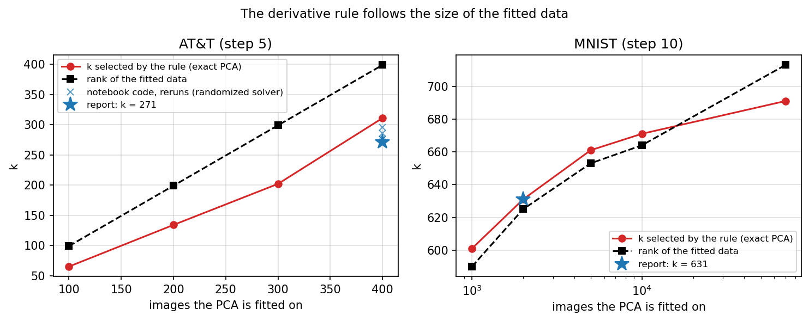
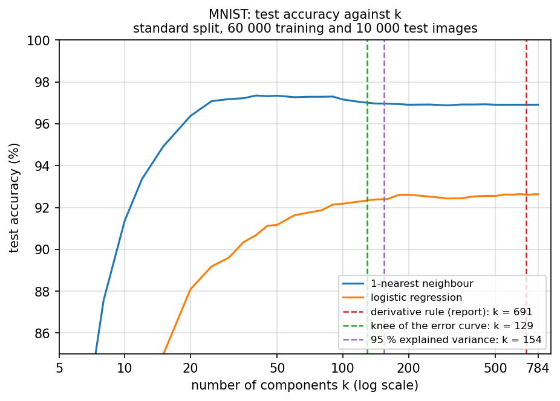

# Kod ve rapor üzerine notlar

[English](notes.md)

## 1. Kodun kaynağı

Rapor ([report.pdf](report.pdf)) bir Google Drive klasörüne bağlantı veriyor. Klasörde iki notebook
(`atnt_opt.ipynb`, `mnist_opt.ipynb`), sunum dosyası ve sunum videosu var. Notebook'lar
[legacy/](../legacy) klasöründe; kodları ve çıktıları değiştirilmedi, yalnızca Colab meta verisi
(kullanıcı kimliği, Drive dosya kimlikleri) silindi. Sunum [presentation.pptx](presentation.pptx)
dosyasında; video depoya eklenmedi.

İki notebook da aynı adımları izliyor:

1. Görüntüleri yükle (piksel değerleri 0–255) ve PCA'yı bu görüntülere uydur.
2. k = 1, 1 + s, 1 + 2s, … için aynı görüntüleri k bileşenle yeniden oluştur ve orijinallere olan
   ortalama Öklid uzaklığını hesapla: E(k).
3. Eğimi, yani dE/dk'yı `np.gradient` ile al.
4. |eğim| ≤ 0,01 olan ilk k'yı seç; böyle bir k yoksa eğimin en büyük olduğu k'yı seç.

## 2. Rapor ile kodun ayrıştığı yerler

- **Kural.** Raporda optimumun, birinci türevin "maksimuma ulaştığı" nokta olduğu ve bu noktanın "en
  dik iyileşmeyi" gösterdiği yazıyor. Oysa E(k) azalan bir eğri; eğimi negatif ve eğimin maksimumu,
  hatanın *en yavaş* azaldığı yer. Kod bunu yapıyor, sunum da öyle anlatıyor ("the point where the
  error decreases least rapidly (derivative closest to zero)"). En dik iyileşme k = 1'de.
- **AT&T ızgarası.** Raporda 10'ar adım deniyor; notebook 5'er adım kullanıyor (`range(1, 401, 5)`).
- **MNIST örneklemi.** Raporda 70 000 görüntü anlatılıyor. Hata eğrisi ise yalnızca ilk 2 000
  görüntüyle hesaplanıyor: PCA bu görüntülere uyduruluyor ve hata yine bunlarda ölçülüyor. Yalnızca
  yeniden oluşturma görselleri 70 000 görüntünün hepsini kullanıyor.
- **Boyut azaltma yüzdeleri.** %32,25 ve %19,52 değerleri 1 − 271/400 ve 1 − 631/784. AT&T'de asıl
  boyut 10 304 piksel, yani 271 bileşen %97,4'lük bir azaltma. 400 sayısı görüntülerin değil, görüntü
  sayısının bir özelliği.
- **Sınıflandırma.** Başlık sınıflandırma başarımından söz ediyor, ama hiçbir sınıflandırıcı
  eğitilmiyor ya da ölçülmüyor.

## 3. Seçilen k neden bir optimum değil

### Örneklem içi hata sıfıra iniyor

PCA N görüntüye uyduruluyor ve hata aynı görüntülerde ölçülüyor. Ortalaması çıkarılmış N görüntü en
fazla N − 1 boyut kaplar. Bu yüzden k = rank'tan (≤ N − 1) itibaren hata tam olarak sıfır, eğim de
öyle. Sıfır eğim arayan bir kural, örneklemin rank'ını bulur
([results/rule_check.md](../results/rule_check.md)):

| MNIST, uydurulan görüntü sayısı (ilk n) | verinin rank'ı | k, adım 1 | k, adım 10 |
|---|---|---|---|
| 1 000 | 590 | 589 | 601 |
| 2 000 | 625 | 624 | 631 |
| 5 000 | 653 | 653 | 661 |
| 10 000 | 664 | 664 | 671 |
| 70 000 | 713 | 680 | 691 |

Rapordaki 631, 2 000 görüntülük örneklemin rank'ından sonraki ilk ızgara noktası. 70 000 görüntünün
hepsiyle aynı kural 691 veriyor.

### AT&T'de sonucu gürültü belirliyor

Adım 5 olunca ızgara k = 396'da, rank'tan (399) önce bitiyor. Hiçbir eğim sıfır olmuyor ve kural en
büyük eğimi seçiyor. Hata bir Öklid uzaklığı, yani artık enerjinin karekökü; bu yüzden eğri rank'a
yaklaşırken yeniden dikleşiyor. Aradaki uzun bölümde eğim neredeyse sabit: en büyük beş eğim
(k = 266 … 311) −3,67 ile −3,72 arasında. Hangisinin en büyük çıkacağını ayrıntılar belirliyor:

- Notebook, sklearn'ün `PCA(n_components=k)` çağrısını varsayılan çözücüyle kullanıyor. Bu veride
  çözücü çoğu k için rastgele (randomized) ve tohumlanmamış. Kod sekiz kez yeniden çalıştırıldığında
  261, 271, 271, 276, 276, 286, 296 ve 311 sonuçları çıktı (beşi
  [results/rule_check.md](../results/rule_check.md) dosyasında). Rapordaki 271 bunlardan biri.
- Kesin (exact) PCA ile sonuç adım 5'te 311, adım 10'da 281, adım 1'de 400.
- Daha az görüntüyle sonuç, görüntü sayısıyla birlikte küçülüyor (yaklaşık 0,65 N):

| AT&T, uydurulan görüntü sayısı (rastgele altkümeler) | rank | k, adım 1 | k, adım 5 | k, adım 10 |
|---|---|---|---|---|
| 100 | 99 | 100 | 65 (56–71) | 61 |
| 200 | 199 | 200 | 134 (126–141) | 133 (131–141) |
| 300 | 299 | 300 | 202 (186–206) | 207 (191–211) |
| 400 | 399 | 400 | 311 | 281 |

### Eşiğin birimi var

|eğim| ≤ 0,01 eşiği, bileşen başına piksel birimiyle ölçülüyor. Pikseller 0–255 yerine 0–1 aralığına
ölçeklenirse aynı kural başka bir k seçiyor.

Kısacası bu kuralın verdiği k, bileşenlerin ne kadar bilgi taşıdığını değil, PCA'nın kaç görüntüye
uydurulduğunu anlatıyor.

## 4. Bileşen başına maliyeti olan bir türev kuralı

k seçimi bir ödünleşim: J(k) = E(k) + λk ifadesini en küçük yapan k aranır; burada λ bir bileşen daha
eklemenin maliyeti.
Optimumda dE/dk = −λ olur: bir bileşen daha, hatayı maliyetinden daha az düşürdüğünde bileşen eklemeyi
bırak. Raporun kuralı λ ≈ 0 durumu; bu yüzden hata sıfırlanana kadar bileşen eklemeye devam ediyor.

Ayar parametresi gerektirmeyen bir λ seçimi, tüm aralık boyunca bileşen başına ortalama kazanç:
λ = (E(1) − E(K)) / (K − 1). Eğimin bu değere eşit olduğu k, eğrinin ilk noktasını son noktasına
bağlayan doğrunun en çok altında kalan noktası, yani dirsek (knee; yumuşatmasız Kneedle).
`pcaselect.selection.knee_rule` bunu uyguluyor. Raporun kendi eğrilerinde k = 61 (AT&T, 400 görüntü)
ve k = 135 (MNIST, 2 000 görüntü) veriyor.

## 5. Sınıflandırma (eklendi)

Başlık sınıflandırma başarımını sorduğu için [scripts/classify.py](../scripts/classify.py) bunu
ölçüyor.

- **Veri.** AT&T: her kişiden 5 eğitim ve 5 test görüntüsüyle 10 rastgele bölme (200 + 200). MNIST:
  standart bölme, 60 000 eğitim ve 10 000 test görüntüsü.
- **k seçiminde test verisi yok.** PCA yalnızca eğitim görüntülerine uyduruluyor ve her kural yalnızca
  eğitim görüntülerini görüyor: örneklem içi hata eğrisinde raporun kuralı (raporda olduğu gibi AT&T'de
  adım 5, MNIST'te adım 10), aynı eğrinin dirseği ve %95 açıklanan varyans.
- **Sınıflandırıcılar.** 1-en yakın komşu (1-NN, klasik eigenfaces tanıyıcısı) ve lojistik regresyon;
  ikisi de ilk k PCA skoru üzerinde çalışıyor.

AT&T ([results/att/classification](../results/att/classification)):

| kural | k | 1-NN (%) | lojistik regresyon (%) |
|---|---|---|---|
| raporun türev kuralı | 137 (126–151) | 93,8 ± 1,0 | 95,6 ± 1,5 |
| hata eğrisinin dirseği | 34 (32–35) | 93,6 ± 1,2 | 95,5 ± 1,5 |
| %95 açıklanan varyans | 115 (114–116) | 93,8 ± 1,0 | 95,8 ± 1,3 |
| tüm bileşenler | 200 | 93,8 ± 0,8 | 95,7 ± 1,4 |
| test kümesindeki en iyi k (referans, kural değil) | | 94,1 (k = 50) | 96,0 (k = 85) |

k: bölmeler üzerinden ortalama (aralık); doğruluk: ortalama ± standart sapma. Dirsek eksi türev
kuralı, bölmeye göre eşleştirilmiş: −0,1 ± 0,8 puan (1-NN) ve −0,1 ± 0,9 puan (lojistik regresyon).

MNIST ([results/mnist/classification](../results/mnist/classification)):

| kural | k | 1-NN (%) | lojistik regresyon (%) |
|---|---|---|---|
| raporun türev kuralı | 691 | 96,91 | 92,63 |
| hata eğrisinin dirseği | 129 | 97,04 | 92,42 |
| %95 açıklanan varyans | 154 | 96,94 | 92,29 |
| tüm bileşenler | 784 | 96,91 | 92,63 |
| test kümesindeki en iyi k (referans, kural değil) | | 97,35 (k = 40) | 92,64 (k = 650) |

Bulgular:

- Doğruluk erken doyuyor: AT&T'de iki sınıflandırıcı için de yaklaşık 40–50 bileşende, MNIST'te
  1-NN için yaklaşık 40, lojistik regresyon için yaklaşık 200 bileşende. Bunun ötesindeki bileşenler
  bir şey katmıyor. MNIST'te 1-NN için hafifçe zarar bile veriyorlar (k = 40'ta %97,35, 784
  bileşenin hepsiyle %96,91): son bileşenler rakamın şeklinden çok piksel gürültüsü taşıyor ve bu gürültü uzaklıklara
  ekleniyor.
- Türev kuralı 137 (AT&T) ve 691 (MNIST) bileşen tutuyor ve bunun karşılığında bir şey kazanmıyor.
- Dirsek 34 ve 129 bileşen tutuyor. AT&T'de türev kuralıyla bölmeler arası gürültü içinde aynı
  sonucu veriyor. MNIST'te 1-NN için 0,13 puan daha iyi, lojistik regresyon için 0,21 puan daha kötü.
- Bir bölmenin 200 eğitim görüntüsüyle raporun kuralı AT&T'de 271 değil, yaklaşık 137 bileşen
  seçiyor: seçilen k yine görüntü sayısını izliyor.
- Sınıflandırıcı biliniyorsa k'yı bir doğrulama kümesindeki doğruluğa göre seçmek en doğrudan yol.
  Bilinmiyorsa dirsek makul bir varsayılan.

## 6. Kodda yapılan değişiklikler

- **Kesin PCA, tek uydurma.** `svd_solver="full"` deterministik. Bileşenler ortonormal olduğu için
  tek bir uydurma her k için eğriyi veriyor: ‖x − x̂ₖ‖² = ‖x − μ‖² − Σⱼ≤ₖ zⱼ². Notebook'lar her k için
  (AT&T'de 80 kez) ve yeniden oluşturma görselindeki her görüntü için (20 kez) PCA'yı baştan
  uyduruyordu. Ayrıca hiç kullanılmayan 10 304 × 10 304'lük bir kovaryans matrisi (0,85 GB)
  hesaplıyor, 2 000 sayı okumak için de `euclidean_distances(X, X_rec).diagonal()` ile
  70 000 × 2 000'lik bir matris (0,56 GB) kuruyordu. `reproduce_report.py` artık veri seti başına
  10–20 saniye sürüyor.
- **Tekrarlanabilir görseller.** Gösterilen görüntüler tohumla seçiliyor. Tüm paneller aynı 0–255 gri
  ölçeğini paylaşıyor. Sabit ölçek olmazsa matplotlib her paneli kendi içinde ölçekliyor; bu da
  bulanıklığı ve parlaklık kaymalarını gizliyor.
- **Veri.** AT&T yüzleri aynı Kaggle veri setinden, `kagglehub` ya da Kaggle hesabı gerekmeden
  indiriliyor. MNIST eskisi gibi OpenML'den geliyor.
- **Testler**: hata eğrisi, kurallar ve veri yükleyici için (`python -m pytest`).

## 7. Bu kontrolün sınırları

- AT&T küçük bir veri seti. Her bölmede 200 test görüntüsü olduğu için doğruluk bölmeden bölmeye
  yaklaşık ±1–1,5 puan oynuyor; kurallar arasındaki bir puandan küçük farklar pek bir şey ifade etmiyor.
- Yalnızca iki basit sınıflandırıcı denendi. Başka bir sınıflandırıcı başka bir k isteyebilir:
  MNIST'te lojistik regresyon yaklaşık 200 bileşene kadar iyileşmeyi sürdürüyor, 1-NN 40–50'de zirve
  yapıyor.
- Dirsek noktası, kendisine verilen k aralığına bağlı; burada bu aralık eğitim kümesinin tüm
  bileşenleri.
